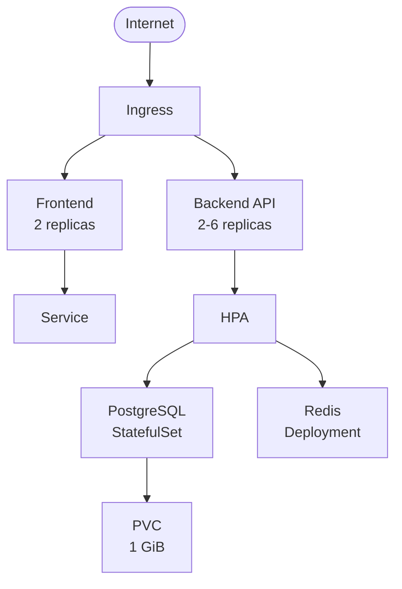

# Resilient Kubernetes Application

This project demonstrates a production-grade, highly resilient infrastructure architecture deployed via Kubernetes manifests and Helm charts. Designed to model real-world enterprise standards, this deployment orchestrates containerized workloads, automates lifecycle management, implements strict security controls, and ensures high availability without requiring custom application code.


# Project Objective

This project demonstrates practical Kubernetes platform-engineering capabilities including:

-   Declarative infrastructure
    
-   Container orchestration
    
-   Service discovery
    
-   Ingress routing
    
-   Horizontal scaling
    
-   Rolling deployments
    
-   Self-healing workloads
    
-   Persistent storage
    
-   Network isolation
    
-   Kubernetes security controls
    
-   Helm-based packaging
    
-   Operational verification and resilience testing

## Architecture





## Components

  

-  `frontend`: NGINX Deployment with two replicas and a ClusterIP Service.

-  `backend`: HTTP API Deployment with two replicas, rolling updates, probes, PDB, and CPU HPA.

-  `postgres`: single-replica StatefulSet with a per-pod PVC.

-  `redis`: internal cache Deployment and ClusterIP Service.

- Ingress routes `/` to the frontend and `/api` to the backend.

- Namespace isolation, default-deny NetworkPolicy, tier-specific traffic rules, non-root security contexts, and resource requests/limits are included.

  

The sample database password is intentionally a placeholder. Supply a real secret for any shared or production cluster.

----------

## Repository Structure

```text
.
├── manifests/
│   ├── namespace.yaml
│   ├── config/
│   ├── frontend/
│   ├── backend/
│   ├── postgres/
│   ├── redis/
│   ├── ingress/
│   ├── network-policy/
│   └── kustomization.yaml
│
├── helm/
│   └── resilient-app/
│       ├── Chart.yaml
│       ├── values.yaml
│       └── templates/
│
└── README.md

```

----------

# Deployment

## Prerequisites

Install and configure:

-   Kubernetes cluster
    
-   `kubectl`
    
-   Kustomize support through `kubectl`
    
-   Helm 3
    
-   An Ingress Controller
    
-   Metrics Server for HPA functionality
    

Verify the cluster:

```bash
kubectl cluster-info
kubectl get nodes

```

----------

## Option 1: Deploy with Kubernetes Manifests

Apply the complete application:

```bash
kubectl apply -k manifests/

```

Verify the deployment:

```bash
kubectl -n resilient-app get pods
kubectl -n resilient-app get svc
kubectl -n resilient-app get pvc
kubectl -n resilient-app get hpa
kubectl -n resilient-app get ingress

```

Check rollout status:

```bash
kubectl -n resilient-app rollout status deployment/frontend
kubectl -n resilient-app rollout status deployment/backend

```

Check the overall application state:

```bash
kubectl -n resilient-app get all

```

If an Ingress Controller is not available, the services can be tested using `kubectl port-forward`.

----------

# Option 2: Deploy with Helm

Install or upgrade the application:

  

```bash

helm  upgrade  --install  resilient-app  ./helm/resilient-app  --namespace  resilient-app  --create-namespace  --take-ownership  --set  database.password='!@replace-this-secret'

```  


#

add --force-conflicts flag to override conflicts if any:

  

```bash

helm  upgrade  --install  resilient-app  ./helm/resilient-app  --namespace  resilient-app  --create-namespace  --take-ownership  --server-side=true  --force-conflicts  --set  database.password='!@replace-this-secret'

```

 Verify the release:

```bash
helm -n resilient-app status resilient-app

```

Verify the Kubernetes resources:

```bash
kubectl -n resilient-app get pods,svc,pvc,hpa,ingress

```

----------

# Resilience Testing

The following tests validate the application's resilience characteristics.

> **Important:** The repository contains the test procedures, but no live Kubernetes cluster was available during preparation. Therefore, zero-downtime, self-healing, HPA scaling, and persistent-storage results must be captured after deployment. Do not report these tests as passed until they have been executed successfully on the target cluster.

## 1. Zero-Downtime Rolling Update

Start a continuous request loop:

```bash
kubectl -n resilient-app port-forward svc/frontend 8080:80

```

In another terminal:

```bash
while true; do
  curl -fsS -o /dev/null http://127.0.0.1:8080/ || echo "5xx or unavailable"
done

```

Trigger a rolling update:

```bash
kubectl -n resilient-app set image deployment/frontend nginx=nginx:1.27.1-alpine

```

Monitor the rollout:

```bash
kubectl -n resilient-app rollout status deployment/frontend

```

The frontend Deployment uses:

```text
maxSurge: 1
maxUnavailable: 0

```

The request loop should continue without failed requests during the update.

----------

## 2. Self-Healing

Identify a backend pod:

```bash
POD=$(kubectl -n resilient-app get pod \
  -l app=backend \
  -o jsonpath='{.items[0].metadata.name}')

```

Delete the pod:

```bash
kubectl -n resilient-app delete pod "$POD"

```

Watch the replacement:

```bash
kubectl -n resilient-app get pods -l app=backend -w

```

The Deployment controller should automatically create a replacement pod.

The replacement should become Ready before receiving application traffic.

----------

## 3. Horizontal Pod Autoscaling

Generate continuous traffic against the backend:

```bash
kubectl -n resilient-app run load \
  --rm -it \
  --image=busybox:1.36 \
  -- sh -c 'while true; do wget -q -O- http://backend:8080/ >/dev/null; done'

```

Monitor the HPA:

```bash
kubectl -n resilient-app get hpa backend -w

```

Also monitor the backend pods:

```bash
kubectl -n resilient-app get pods -l app=backend -w

```

HPA scale-up requires:

-   Metrics Server
    
-   CPU resource requests configured on the backend
    
-   Sufficient CPU utilization generated by the workload
    

Observe the `TARGETS` and `REPLICAS` values to confirm scaling activity.

----------

## 4. PostgreSQL Persistence

Create a test record:

```bash
kubectl -n resilient-app exec statefulset/postgres -- \
  sh -c 'psql -U "$POSTGRES_USER" -d "$POSTGRES_DB" -c "CREATE TABLE IF NOT EXISTS resilience_check (id int); INSERT INTO resilience_check VALUES (1);"'

```

Delete the PostgreSQL pod:

```bash
kubectl -n resilient-app delete pod postgres-0

```

Wait for the pod to become Ready:

```bash
kubectl -n resilient-app wait \
  --for=condition=ready \
  pod/postgres-0 \
  --timeout=180s

```

Verify the record:

```bash
kubectl  -n  resilient-app  exec  statefulset/postgres  --  psql  -U  appuser  -d  appdb  -c  "CREATE TABLE IF NOT EXISTS │ resilience_check (id int); INSERT INTO resilience_check VALUES (1);"; 

kubectl  -n  resilient-app  exec  statefulset/
│  postgres  --  psql  -U  appuser  -d  appdb  -c  "SELECT * FROM resilience_check;"

```

The test record should remain available because the recreated PostgreSQL pod attaches to the same PersistentVolumeClaim.

> A production PostgreSQL deployment should additionally include backups, replication, monitoring, recovery procedures, and appropriate database operational controls.

----------

# Verification

After deployment, verify:

```text
[x] Namespace created
[x] Frontend pods Running and Ready
[x] Backend pods Running and Ready
[x] PostgreSQL pod Running and Ready
[x] Redis pod Running and Ready
[x] Services available
[x] PostgreSQL PVC Bound
[x] Ingress configured
[x] NetworkPolicies applied
[x] HPA reports metrics
[x] Frontend rolling update completes
[x] Backend pod self-heals
[x] Backend HPA scales under load
[x] PostgreSQL data survives pod recreation

```

Useful verification command:

```bash
kubectl -n resilient-app get pods,svc,pvc,hpa,ingress

```

----------

# Security Considerations

The deployment applies several Kubernetes security practices:

-   Workloads run as non-root where supported.
    
-   Resource requests and limits are defined.
    
-   Network traffic is restricted using NetworkPolicy.
    
-   PostgreSQL and Redis are exposed internally through ClusterIP services.
    
-   The application is isolated within the `resilient-app` namespace.
    
-   Database credentials are supplied through Kubernetes configuration rather than hard-coded application code.
    

For production use, credentials should be managed through an appropriate secret-management solution such as an external secrets provider or cloud secret manager.

----------

# Cleanup

Remove the manifest deployment:

```bash
kubectl delete -k manifests/

```

If the Helm deployment was used:

```bash
helm uninstall resilient-app -n resilient-app

```

Remove the namespace if required:

```bash
kubectl delete namespace resilient-app

```

----------
